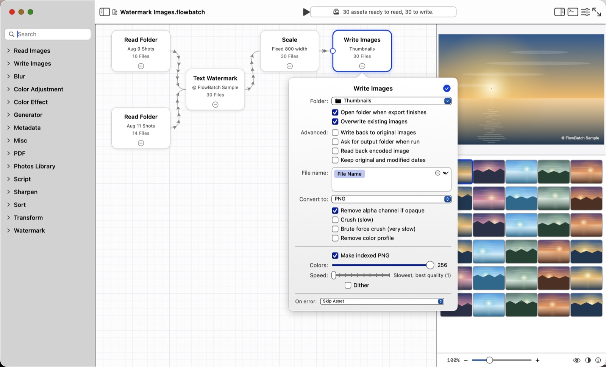
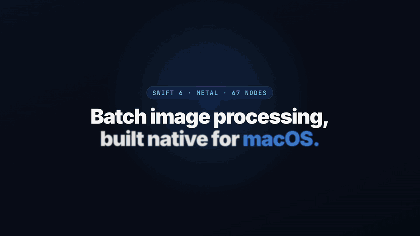
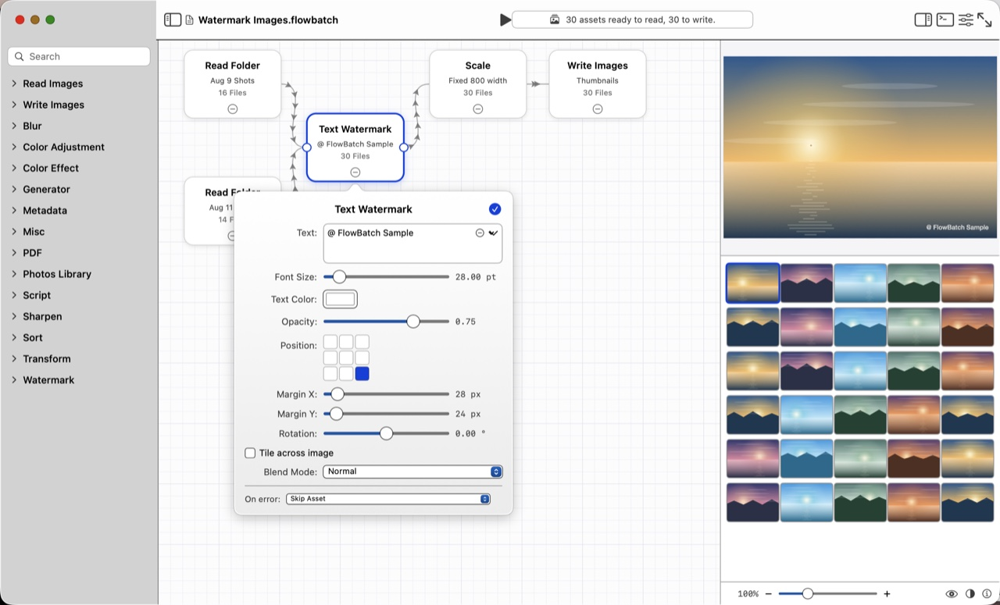
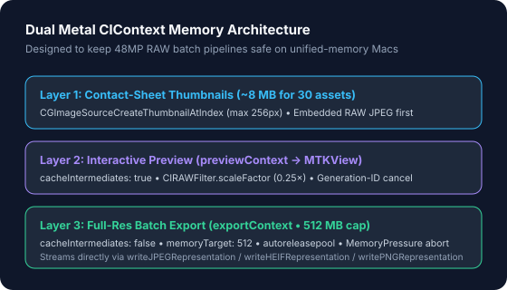
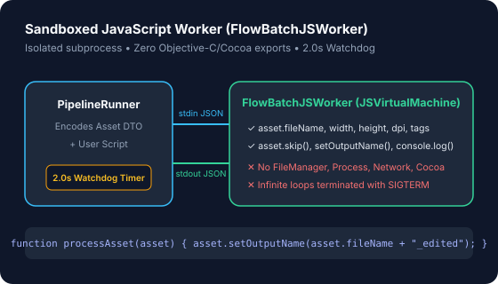

<div align="center">


<h1>FlowBatch Studio</h1>

<p><strong>Native macOS node-based batch image processor built with Swift 6, AppKit, SwiftUI, Metal &amp; Core Image.</strong></p>

<p>
  <a href="https://github.com/zm57cdj9yb-beep/flowbatch-studio/releases/latest">
    
  </a>
  
  
  
  
  <a href="LICENSE">
    
  </a>
</p>

<p>
  <a href="https://github.com/zm57cdj9yb-beep/flowbatch-studio/releases/latest">
    
  </a>
</p>

<p>
  <a href="#-live-demo">Live Demo</a> •
  <a href="#-features">Features</a> •
  <a href="#%EF%B8%8F-under-the-hood">Architecture</a> •
  <a href="#-download--build-from-source">Quick Start</a> •
  <a href="#-all-67-built-in-nodes">All 67 Nodes</a> •
  <a href="#-faq">FAQ</a> •
  <a href="#-roadmap">Roadmap</a>
</p>

<br />



<p><sub><em>Live macOS capture — 15-category searchable Node Library, 60fps AppKit Graph Canvas with anchored Write Images Popover, and live Metal Preview + 30-asset Thumbnail Contact Sheet.</em></sub></p>

<br />

<table>
  <tr>
    <td width="25%" valign="top">
      <strong>🧩 67 Native Nodes</strong><br />
      <sub>15 collapsible categories from Read/Write, Blur &amp; Color to PDF, Vision ML, Photos &amp; Scripts.</sub>
    </td>
    <td width="25%" valign="top">
      <strong>⚡ Metal + 512MB Cap</strong><br />
      <sub>Separate preview and export <code>CIContext</code>s with 256px thumbnails &amp; <code>autoreleasepool</code> streaming.</sub>
    </td>
    <td width="25%" valign="top">
      <strong>🗜️ Clean-Room Indexed PNG</strong><br />
      <sub>Median-Cut (2–256 colors), Floyd-Steinberg dither &amp; manual <code>PLTE</code>/<code>tRNS</code>/<code>zlib</code> chunk crush.</sub>
    </td>
    <td width="25%" valign="top">
      <strong>🔒 Sandboxed JS Worker</strong><br />
      <sub>Isolated <code>JavaScriptCore</code> subprocess with zero Cocoa access and a hard 2.0s watchdog timer.</sub>
    </td>
  </tr>
</table>

</div>

---

## 🎬 Live Demo

<div align="center">



<p><sub><em>26.5s interactive launch edit created with <a href="https://github.com/heygen-com/hyperframes">HyperFrames</a> — showing live Metal thumbnail scrubbing, 300% zoom, Dark Backdrop + EXIF HUD, and instant sidebar search. <a href="https://github.com/zm57cdj9yb-beep/flowbatch-studio/releases/latest">Watch / download full 1080p MP4 on Releases →</a></em></sub></p>

</div>

---

## ✨ Features

<table>
  <tr>
    <td width="50%" valign="top">
      
      <br /><br />
      <strong>Visual DAG Branching &amp; Live Metal Filters</strong>
      <p>Search all 67 nodes across 15 categories and double-click to auto-wire straight onto the graph. Directional chevron Bézier wires, cycle detection, <code>Rules</code> dual-port routing (<em>Matched / Unmatched</em>), <code>Multi Scale</code> fan-out, and instant GPU-accelerated Core Image previews.</p>
    </td>
    <td width="50%" valign="top">
      
      <br /><br />
      <strong>Clean-Room Indexed PNG &amp; 10 Export Formats</strong>
      <p>Manual <code>CZlib</code> (<code>-lz</code>) PNG chunk writer (<code>IHDR → sRGB → PLTE → tRNS → IDAT → IEND</code>) with Median-Cut quantization (2–256 colors), configurable speed (1–10), Floyd-Steinberg dithering, adaptive 1/2/4/8-bpp packing, and multi-strategy <em>Brute Force Crush</em> — alongside JPEG, HEIC, AVIF, TIFF, GIF, JP2, BMP, PDF, and PSD.</p>
    </td>
  </tr>
  <tr>
    <td width="50%" valign="top">
      
      <br /><br />
      <strong>Dynamic Watermarks &amp; Tokenized File Naming</strong>
      <p>Overlay stylized text or image watermarks with a 3×3 anchor grid, blend modes, rotation, tiling, and live preview. Expand dynamic tokens like <code>[File Name]</code>, <code>[Width]</code>, <code>[Height]</code>, <code>[Counter]</code>, <code>[Date]</code>, <code>[Author]</code>, and Vision ML <code>[Classification]</code> across output filenames and metadata.</p>
    </td>
    <td width="50%" valign="top">
      
      <br /><br />
      <strong>Dark Studio Backdrop, Compare &amp; EXIF HUD</strong>
      <p>Scrub 256px ImageIO contact sheets at 60fps, zoom up to 300%, toggle Original vs. Processed comparison, switch between Light/Dark preview backdrops, and inspect dimensions, DPI, bit depth, color profile, camera model, and GPS privacy status in one click.</p>
    </td>
  </tr>
  <tr>
    <td width="50%" valign="top">
      
      <br /><br />
      <strong>Dual-CIContext 48MP Memory Budget</strong>
      <p>Separates a cached GPU <code>previewContext</code> (<code>MTKView</code> via <code>CIRenderDestination</code> + <code>CIRAWFilter.scaleFactor</code>) from a bounded <code>exportContext</code> (<code>.cacheIntermediates: false</code>, <code>.memoryTarget: 512</code> MB) with per-asset <code>autoreleasepool</code> streaming and memory-pressure abort handling.</p>
    </td>
    <td width="50%" valign="top">
      
      <br /><br />
      <strong>Sandboxed Scripting &amp; Automation</strong>
      <p>Run custom <code>processAsset(asset)</code> JavaScript inside the isolated <code>FlowBatchJSWorker</code> subprocess with zero access to <code>FileManager</code> or Cocoa APIs and automatic 2.0s watchdog termination, alongside <code>Shell Script</code> (<code>/bin/zsh</code>) and <code>AppleScript</code> nodes.</p>
    </td>
  </tr>
</table>

---

## ⚙️ Under the Hood

<table>
  <tr>
    <td width="33%" valign="top">
      <strong>🔀 Topological Execution</strong><br /><br />
      <code>WorkflowDocumentModel</code> validates DAG edges against cycles, resolves deterministic visual execution order, and runs isolated per-node <code>NodeErrorPolicy</code> strategies (<em>Skip Asset</em>, <em>Halt Workflow</em>, <em>Pass Input Through</em>).
    </td>
    <td width="33%" valign="top">
      <strong>🖼️ Subsampled Thumbnails</strong><br /><br />
      <code>ThumbnailLoader</code> strictly decodes grid tiles via <code>CGImageSourceCreateThumbnailAtIndex</code> capped at <code>256px</code>, checking embedded RAW previews first (<code>FromImageIfAbsent</code>) inside a 64 MB LRU <code>NSCache</code>.
    </td>
    <td width="33%" valign="top">
      <strong>🧠 Vision ML &amp; PDFKit</strong><br /><br />
      Built-in Apple <code>Vision</code> (<code>VNClassifyImageRequest</code>) feeds tags into <code>Rules</code> and filename tokens, while <code>PDFKit</code> + <code>ImageIO</code> power <code>PDF Maker</code>, <code>PDF Image Extractor</code>, <code>Animated Image</code>, and <code>Layer &amp; Page Splitter</code>.
    </td>
  </tr>
  <tr>
    <td width="33%" valign="top">
      <strong>↺ Coalesced Undo/Redo</strong><br /><br />
      Dragging nodes across the canvas or scrubbing continuous inspector sliders commits exactly one <code>UndoManager</code> snapshot upon release while keeping the live Metal preview responsive at every frame.
    </td>
    <td width="33%" valign="top">
      <strong>🧰 Starter Workflow Ready</strong><br /><br />
      First launch loads <code>Watermark Images.flowbatch</code> with 30 locally generated sample JPEGs across two <code>Read Folder</code> nodes (16 + 14) wired through <code>Text Watermark</code>, <code>Scale</code> (800px), and indexed <code>Write Images</code>.
    </td>
    <td width="33%" valign="top">
      <strong>📦 Pure Native Swift 6</strong><br /><br />
      Zero Electron overhead and zero third-party Swift package dependencies. <code>scripts/build_app.sh</code> compiles <code>AppIcon.svg</code> via <code>iconutil</code>, generates starter assets, builds release binaries, and signs helpers individually.
    </td>
  </tr>
</table>

---

## 🚀 Download & Build From Source

### Option 1 — Pre-Built Release (macOS Apple Silicon, macOS 14+)
1. Download **`FlowBatch-Studio-v1.0.0-macOS-arm64.zip`** from the [Latest GitHub Release](https://github.com/zm57cdj9yb-beep/flowbatch-studio/releases/latest).
2. Unzip and move **`FlowBatch Studio.app`** to `/Applications`.
3. Because this open-source release is **ad-hoc signed** (not Apple Developer notarized), clear the macOS quarantine attribute once before opening:
   ```bash
   xattr -dr com.apple.quarantine "/Applications/FlowBatch Studio.app"
   open "/Applications/FlowBatch Studio.app"
   ```

### Option 2 — Build & Sign Locally From Source (Recommended)
**Requirements:** macOS 14.0+ (Sonoma or newer) and Xcode / Swift 6 toolchain (`swift`, `codesign`, `iconutil`).

```bash
git clone https://github.com/zm57cdj9yb-beep/flowbatch-studio.git
cd flowbatch-studio

# 1. Build all targets (including FlowBatchJSWorker) and run all 20 automated tests
swift build
swift test

# 2. Generate vector AppIcon.icns, demo assets, and build/sign the release .app bundle
./scripts/build_app.sh release

# 3. Verify individual & bundle signatures and launch the app
codesign --verify --strict --verbose=2 "build/FlowBatch Studio.app"
open "build/FlowBatch Studio.app"
```

---

## ❓ FAQ

<details>
<summary><b>How does the memory budget handle large images without crashing?</b></summary>
<br />
<code>PipelineRunner</code> enforces a strict split between interactive preview and export:
<ul>
  <li><b>Contact Sheet:</b> Decodes at most <code>256px</code> thumbnails via <code>CGImageSourceCreateThumbnailAtIndex</code> (never loading full rasters into the grid).</li>
  <li><b>Preview Pane:</b> Renders into <code>MTKView</code> with <code>previewContext</code> (<code>cacheIntermediates: true</code>), applying <code>CIRAWFilter.scaleFactor</code> (0.25×) and macOS 27 <code>CIImageOption.subsampleFactor</code>.</li>
  <li><b>Batch Export:</b> Uses a separate <code>exportContext</code> (<code>cacheIntermediates: false</code>, <code>memoryTarget: 512</code> MB) inside per-asset <code>autoreleasepool</code> blocks, capping full-res export concurrency to <code>1</code> on ≤16 GB Macs or &gt;24MP/RAW assets, and cancelling active exports cleanly on <code>.critical</code> memory pressure.</li>
</ul>
</details>

<details>
<summary><b>What happens when Photos, Screen Recording, or AppleEvents permissions are denied?</b></summary>
<br />
FlowBatch Studio checks authorization cleanly instead of crashing:
<ul>
  <li><code>Read Photos Library</code> / <code>Import to Photos</code> surface <code>NodeExecutionError.authorizationDenied</code> with an inline <em>Open Privacy Settings…</em> action inside the node popover.</li>
  <li><code>Screenshot</code> (<code>ScreenCaptureKit</code>) and <code>AppleScript</code> catch denied TCC states and log structured errors to the collapsible Workflow Console according to each node's <code>NodeErrorPolicy</code>.</li>
</ul>
</details>

<details>
<summary><b>How is the project tested and verified?</b></summary>
<br />
<ul>
  <li><b>Automated test suite (<code>20/20</code> passing):</b> Covers all 67 node type IDs, starter graph dry-run counts (<code>30 read, 30 write</code> &amp; <code>Multi Scale</code> <code>30 → 60</code>), coalesced <code>UndoManager</code>, token expansion, manual PNG chunk assembly (<code>IHDR</code>/<code>PLTE</code>/<code>tRNS</code>/Crush), <code>PDF Maker</code>, <code>Scale</code>, <code>Remove GPS</code>, <code>Rules</code>, <code>FlowBatchJSWorker</code> isolation &amp; 2s watchdog timeout, 256px thumbnail downsampling, 24MP HEIC export, and full 30-asset indexed PNG batch export.</li>
  <li><b>Interactive macOS UI verification:</b> Verified in windowed and native macOS fullscreen modes across sidebar search, live Metal preview scrubbing, popover switching, Dark Backdrop, EXIF HUD, and batch export.</li>
</ul>
</details>

<details>
<summary><b>Why is WebP export not listed in the output formats?</b></summary>
<br />
macOS <code>ImageIO</code> (<code>CGImageDestinationCopyTypeIdentifiers()</code>) supports WebP decoding but does not natively ship a WebP encoder. FlowBatch Studio exports directly to PNG (standard &amp; indexed), JPEG, HEIC, AVIF, TIFF, GIF (including animated), JPEG 2000, BMP, PDF, and PSD.
</details>

---

## 📊 Reference & Hardware Concurrency Tiers

| Mac Unified Memory | ≤24MP Export Concurrency | >24MP / RAW Concurrency | Export `CIContext` Target |
|---|:---:|:---:|---|
| **8–16 GB** | `1` asset at a time (`autoreleasepool`) | `1` asset at a time | `memoryTarget: 512` MB, `cacheIntermediates: false` |
| **32 GB** | `2` concurrent exports | `1` asset at a time | `memoryTarget: 512` MB, `cacheIntermediates: false` |
| **64 GB+** | `4` concurrent exports | `1` asset at a time | `memoryTarget: 512` MB, `cacheIntermediates: false` |

---

## 🧩 All 67 Built-In Nodes

<details>
<summary><b>Expand complete 15-category / 67-node inventory</b></summary>
<br />

| Category | Nodes |
|---|---|
| **Read Images (5)** | `Read Folder`, `Read Individual Files`, `Prompt for Files`, `Clipboard`, `RAW Process` |
| **Write Images (4)** | `Write Images`, `Write to Clipboard`, `Open in Another App`, `Multi Scale` |
| **Blur (5)** | `Gaussian Blur`, `Box Blur`, `Motion Blur`, `Noise Reduction`, `Pixelate` |
| **Color Adjustment (7)** | `Exposure`, `Brightness & Contrast`, `Vibrance`, `Gamma`, `Temperature & Tint`, `Shadows & Highlights`, `Color Profile` |
| **Color Effect (10)** | `Photo Effect`, `Sepia`, `Color Invert`, `Color Posterize`, `1-Bit`, `Dither`, `Matte`, `Add Border`, `Drop Shadow`, `Document Enhancer` |
| **Generator (4)** | `Blank Image`, `Screenshot`, `Image Grid`, `Animated Image` |
| **Metadata (5)** | `Delete Metadata`, `Remove GPS`, `Set DPI`, `Set General Metadata`, `Fix EXIF Rotation` |
| **Misc (7)** | `Change Bits Per Channel`, `Duplicate`, `Delay`, `Layer & Page Splitter`, `Extract Portrait Matte`, `Contrast Stretch`, `Custom Convolution` |
| **PDF (2)** | `PDF Maker`, `PDF Image Extractor` |
| **Photos Library (2)** | `Read Photos Library`, `Import to Photos` |
| **Script (3)** | `JavaScript`, `Shell Script`, `AppleScript` |
| **Sharpen (2)** | `Sharpen Luminance`, `Unsharp Mask` |
| **Sort (3)** | `Rules`, `Classify Images`, `Sort Order` |
| **Transform (6)** | `Scale`, `Crop`, `Rotate`, `Flip`, `Trim to Edges`, `ML Super Resolution` |
| **Watermark (2)** | `Text Watermark`, `Image Watermark` |

</details>

---

## 🛠️ Tech Stack

| Layer | Technology | Role |
|---|---|---|
| **Window & Canvas** | AppKit (`NSWindow`, `NSSplitViewController`, `NSView`, `NSPopover`) | Unified toolbar, 60fps grid/wire drawing, drag-drop & VoiceOver A11y |
| **Sidebars & Inspectors** | SwiftUI + Observation (`@Observable`) | 15-category searchable library, popover controls & thumbnail grid |
| **GPU Rendering** | Metal + `MTKView` + Core Image (`CIContext`, `CIRenderDestination`) | Hardware-accelerated filters, live preview & streaming disk exports |
| **Imaging & Documents** | `ImageIO`, `CIRAWFilter`, `PDFKit`, `Vision`, `PhotoKit`, `ScreenCaptureKit` | Downsampled thumbnails, RAW, PDFs, ML tagging, Photos & capture |
| **Compression & Scripting** | `CZlib` (`-lz`) + `JavaScriptCore` (`FlowBatchJSWorker`) | Manual indexed PNG chunk writer & isolated 2s-timeout JS execution |
| **Launch Video** | [HyperFrames](https://github.com/heygen-com/hyperframes) (`promo-video/`) | Deterministic HTML/GSAP 1080p launch edit built from real app footage |

---

## 🗺️ Roadmap

| Milestone | Platform | Status | Scope |
|---|---|---|---|
| **v1.0 Core & 67 Nodes** | macOS 14+ (Swift 6) | **Released (`v1.0.0`)** | Full 15-category node suite, Metal preview, indexed PNG, `.flowbatch` JSON, 20/20 tests |
| **v1.1 Distribution Polish** | macOS 14+ | **Planned** | Apple Developer ID notarization, signed DMG installer, Homebrew Cask |
| **v2.0 Cross-Platform** | Windows 11 | **Planned** | Tauri 2 + Rust (`image` / `rayon` / `oxipng` / `pdfium`) port |

---

## ⭐ Star History

<div align="center">

<a href="https://star-history.com/#zm57cdj9yb-beep/flowbatch-studio&Date">
  <picture>
    <source media="(prefers-color-scheme: dark)" srcset="https://api.star-history.com/svg?repos=zm57cdj9yb-beep/flowbatch-studio&type=Date&theme=dark" />
    <source media="(prefers-color-scheme: light)" srcset="https://api.star-history.com/svg?repos=zm57cdj9yb-beep/flowbatch-studio&type=Date" />
    
  </picture>
</a>

<br /><br />

**Released under the [MIT License](LICENSE).**

<p><sub>If FlowBatch Studio helps your workflow or serves as a reference for native Swift 6 / Metal / AppKit architecture, give it a ⭐!</sub></p>

<p><a href="#flowbatch-studio">↑ Back to top</a></p>

</div>
