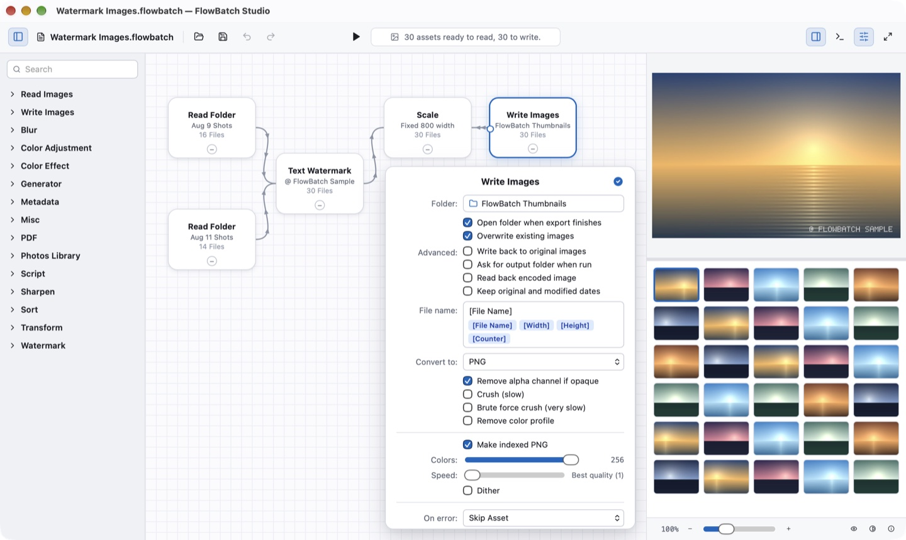
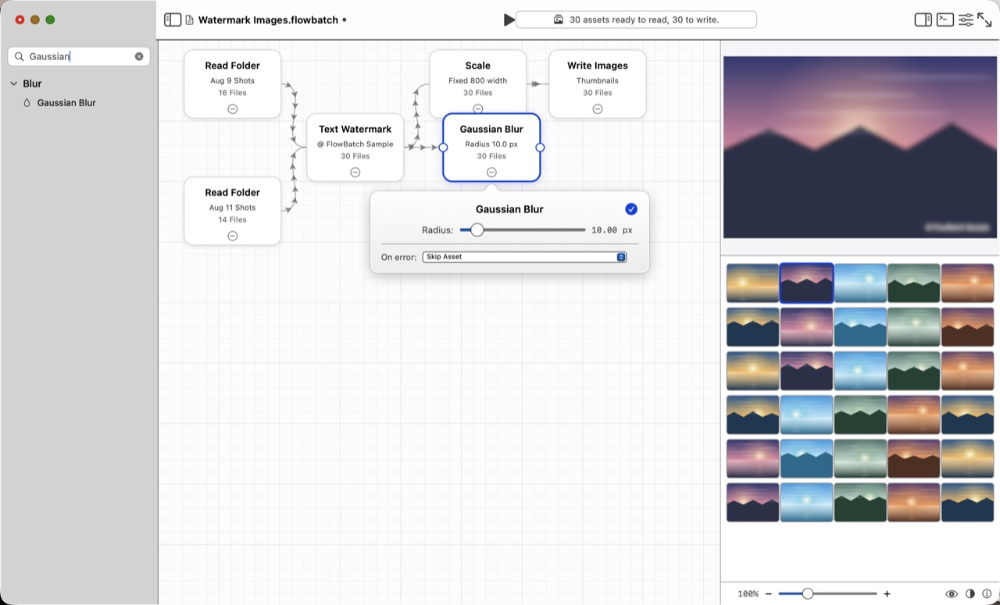
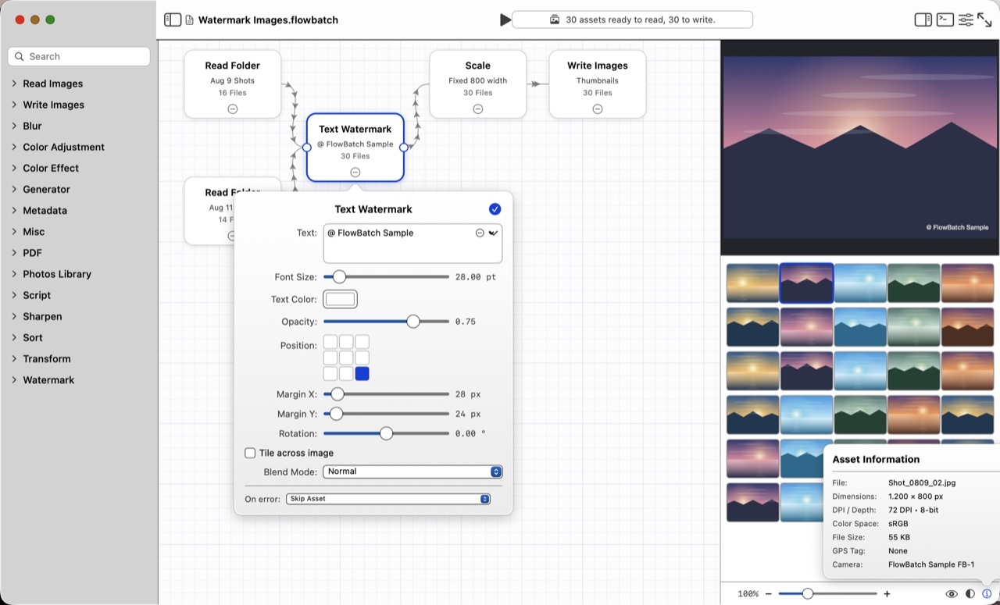

<div align="center">


<h1>FlowBatch Studio</h1>

<p><strong>Cross-platform node-based batch image processor — Native Swift 6 + Metal on macOS &amp; Tauri 2 + Rust on Windows 11.</strong></p>

<p>
  <a href="https://github.com/zm57cdj9yb-beep/flowbatch-studio/releases/latest">
    
  </a>
  
  
  
  
  <a href="LICENSE">
    
  </a>
</p>

<p>
  <a href="#-windows-11-x64--build-from-source--installers">
    
  </a>
  &nbsp;
  <a href="https://github.com/zm57cdj9yb-beep/flowbatch-studio/releases/latest">
    
  </a>
</p>

<p>
  <a href="#-live-demo">Live Demo</a> •
  <a href="#-windows-11-edition-tauri-2--rust">Windows 11</a> •
  <a href="#-features">Features</a> •
  <a href="#%EF%B8%8F-under-the-hood">Architecture</a> •
  <a href="#-download--build-from-source">Download &amp; Build</a> •
  <a href="#-all-67-built-in-nodes">All 67 Nodes</a> •
  <a href="#-faq">FAQ</a> •
  <a href="#-roadmap">Roadmap</a>
</p>

<br />


<p><sub><em>Live macOS capture — 15-category searchable Node Library, 60fps AppKit Graph Canvas with anchored Write Images Popover, and live Metal Preview + 30-asset Thumbnail Contact Sheet.</em></sub></p>

<br />

<table>
  <tr>
    <td width="25%" valign="top">
      <strong>🧩 67 Cross-Platform Nodes</strong><br />
      <sub>15 collapsible categories from Read/Write, Blur &amp; Color to PDF, Rules, Watermarks &amp; Scripts — 1:1 parity on macOS &amp; Windows 11.</sub>
    </td>
    <td width="25%" valign="top">
      <strong>⚡ Metal + Rayon Speed</strong><br />
      <sub>GPU-accelerated Core Image + 512MB budget on macOS; multi-core Rust <code>rayon</code> parallel pipelines inside a ~5.6 MB Tauri 2 binary on Windows 11.</sub>
    </td>
    <td width="25%" valign="top">
      <strong>🗜️ Clean-Room Indexed PNG</strong><br />
      <sub>Median-Cut (2–256 colors), Floyd-Steinberg dither &amp; manual <code>PLTE</code>/<code>tRNS</code>/<code>zlib</code> chunk assembly + <code>oxipng</code> brute-force crush.</sub>
    </td>
    <td width="25%" valign="top">
      <strong>🔄 Shared <code>.flowbatch</code> Format</strong><br />
      <sub>Save a workflow on macOS, open &amp; run it directly on Windows 11 (and vice versa) with full JSON wire compatibility.</sub>
    </td>
  </tr>
</table>

</div>

---

## 🎬 Live Demo

<div align="center">


<p><sub><em>26.5s interactive launch edit created with <a href="https://github.com/heygen-com/hyperframes">HyperFrames</a> — showing live Metal thumbnail scrubbing, 300% zoom, Dark Backdrop + EXIF HUD, and instant sidebar search. <a href="https://github.com/zm57cdj9yb-beep/flowbatch-studio/releases/latest">Watch / download full 1080p MP4 on Releases →</a></em></sub></p>

</div>

---

## 🪟 Windows 11 Edition (Tauri 2 + Rust)

<div align="center">



<p><sub><em>FlowBatch Studio v2.0 (<code>windows/</code>) — Windows 11 Fluent 3-pane workspace powered by Tauri 2, React/TypeScript, and a pure-Rust 67-node processing backend (~5.6 MB release binary, zero Electron bloat).</em></sub></p>

</div>

<table>
  <tr>
    <td width="33%" valign="top">
      <strong>🦀 Pure-Rust 67-Node Engine</strong><br /><br />
      Built in <code>windows/src-tauri</code> with <code>image</code>, <code>rayon</code>, <code>oxipng</code>, and <code>flate2</code>. Includes clean-room Median-Cut indexed PNG encoding with a 32K RGB555 LUT, pure-Rust multi-page PDF 1.4 Maker/Extractor, and WebP/ICO/PNG/JPEG/TIFF/GIF/BMP export.
    </td>
    <td width="33%" valign="top">
      <strong>🔁 100% <code>.flowbatch</code> Parity</strong><br /><br />
      Custom Rust serde matches Swift's exact <code>NodeParamValue</code> JSON encoding so every <code>.flowbatch</code> workflow created on macOS loads seamlessly on Windows 11 — mapping Photos Library to Windows Pictures and AppleScript to PowerShell.
    </td>
    <td width="33%" valign="top">
      <strong>📦 Native <code>.exe</code> &amp; <code>.msi</code> Targets</strong><br /><br />
      Configured for Windows 11 x64 <strong>NSIS <code>.exe</code></strong> and <strong><code>.msi</code></strong> bundling via Tauri 2 (with WebView2 bootstrapper fallback) and verified by <code>7/7</code> Rust release pipeline tests.
    </td>
  </tr>
</table>

---

## ✨ Features

<table>
  <tr>
    <td width="50%" valign="top">
      
      <br /><br />
      <strong>Visual DAG Branching &amp; Live Filters</strong>
      <p>Search all 67 nodes across 15 categories and double-click or drag straight onto the graph. Directional chevron Bézier wires, DAG cycle detection, <code>Rules</code> dual-port routing (<em>Matched / Unmatched</em>), <code>Multi Scale</code> fan-out, and instant live previews on both macOS Metal and Windows 11 Rust.</p>
    </td>
    <td width="50%" valign="top">
      
      <br /><br />
      <strong>Clean-Room Indexed PNG &amp; Modern Formats</strong>
      <p>Manual PNG chunk writer (<code>IHDR → sRGB → PLTE → tRNS → IDAT → IEND</code>) with Median-Cut quantization (2–256 colors), configurable speed (1–10), Floyd-Steinberg dithering, adaptive 1/2/4/8-bpp packing, and multi-strategy <em>Brute Force Crush</em> (<code>CZlib</code> on macOS / <code>oxipng</code> on Windows) — alongside JPEG, HEIC, AVIF, WebP, TIFF, GIF, JP2, BMP, ICO, PDF, and PSD.</p>
    </td>
  </tr>
  <tr>
    <td width="50%" valign="top">
      
      <br /><br />
      <strong>Dynamic Watermarks &amp; Tokenized File Naming</strong>
      <p>Overlay stylized text or image watermarks with a 3×3 anchor grid, blend modes, rotation, tiling, and live preview. Expand dynamic tokens like <code>[File Name]</code>, <code>[Width]</code>, <code>[Height]</code>, <code>[Counter]</code>, <code>[Date]</code>, <code>[Author]</code>, and <code>[Classification]</code> across output filenames and metadata.</p>
    </td>
    <td width="50%" valign="top">
      
      <br /><br />
      <strong>Dark Studio Backdrop, Compare &amp; EXIF HUD</strong>
      <p>Scrub 256px contact sheets at 60fps, zoom up to 300%, toggle Original vs. Processed comparison, switch between Light/Dark preview backdrops, and inspect dimensions, DPI, bit depth, color profile, camera model, and GPS privacy status in one click.</p>
    </td>
  </tr>
  <tr>
    <td width="50%" valign="top">
      
      <br /><br />
      <strong>Dual-CIContext 48MP Memory Budget</strong>
      <p>On macOS, separates a cached GPU <code>previewContext</code> (<code>MTKView</code> via <code>CIRenderDestination</code> + <code>CIRAWFilter.scaleFactor</code>) from a bounded <code>exportContext</code> (<code>.cacheIntermediates: false</code>, <code>.memoryTarget: 512</code> MB) with per-asset <code>autoreleasepool</code> streaming and memory-pressure abort handling.</p>
    </td>
    <td width="50%" valign="top">
      
      <br /><br />
      <strong>Sandboxed Scripting &amp; Automation</strong>
      <p>Run custom <code>processAsset(asset)</code> JavaScript inside the isolated <code>FlowBatchJSWorker</code> subprocess on macOS (zero Cocoa access, 2.0s watchdog) alongside <code>Shell Script</code> (<code>/bin/zsh</code> or <code>cmd</code>/<code>pwsh</code>) and <code>AppleScript</code> / <code>PowerShell</code> automation nodes.</p>
    </td>
  </tr>
</table>

---

## ⚙️ Under the Hood

<table>
  <tr>
    <td width="33%" valign="top">
      <strong>🔀 Topological Execution</strong><br /><br />
      <code>WorkflowDocumentModel</code> validates DAG edges against cycles, resolves deterministic visual execution order, and runs isolated per-node <code>NodeErrorPolicy</code> strategies (<em>Skip Asset</em>, <em>Halt Workflow</em>, <em>Pass Input Through</em>) on both Swift and Rust engines.
    </td>
    <td width="33%" valign="top">
      <strong>🖼️ Subsampled Thumbnails</strong><br /><br />
      Strictly decodes grid tiles capped at <code>256px</code> (<code>CGImageSourceCreateThumbnailAtIndex</code> with 64 MB LRU cache on macOS; fast Rust <code>thumbnail(256, 256)</code> with Base64 data URLs on Windows 11).
    </td>
    <td width="33%" valign="top">
      <strong>📄 Built-In PDF &amp; Vision ML</strong><br /><br />
      macOS uses Apple <code>Vision</code> + <code>PDFKit</code>; Windows 11 ships a zero-C-dependency pure-Rust multi-page PDF 1.4 writer &amp; embedded JPEG extractor alongside built-in brightness/color image classification.
    </td>
  </tr>
  <tr>
    <td width="33%" valign="top">
      <strong>↺ Coalesced Undo/Redo</strong><br /><br />
      Dragging nodes across the canvas or scrubbing continuous inspector sliders commits exactly one undo snapshot upon release while keeping live previews responsive at every frame.
    </td>
    <td width="33%" valign="top">
      <strong>🧰 Starter Workflow Ready</strong><br /><br />
      First launch on either OS loads <code>Watermark Images.flowbatch</code> with 30 locally generated scenic JPEGs across two <code>Read Folder</code> nodes (16 + 14) wired through <code>Text Watermark</code>, <code>Scale</code> (800px), and indexed <code>Write Images</code>.
    </td>
    <td width="33%" valign="top">
      <strong>📦 Zero Bloat Dual Monorepo</strong><br /><br />
      macOS lives at repo root (pure Swift 6, zero third-party packages); Windows 11 lives cleanly inside <code>windows/</code> (Tauri 2 + Rust + React/TS) with independent CI and zero cross-platform conflicts.
    </td>
  </tr>
</table>

---

## 🚀 Download & Build From Source

### 🪟 Windows 11 (x64 — Build From Source & Installers)

**Build locally on Windows 11 (requires Node.js 20+, Rust stable, and Visual Studio C++ Build Tools):**
```powershell
git clone https://github.com/zm57cdj9yb-beep/flowbatch-studio.git
cd flowbatch-studio\windows

# 1. Install frontend dependencies & typecheck/build React UI
npm ci
npm run build

# 2. Run all 7 Rust 67-node backend & pipeline release tests
cd src-tauri
cargo test --release
cd ..

# 3. Build native Windows 11 NSIS (.exe) & MSI (.msi) installers
npx tauri build --bundles nsis,msi
```

### 🍎 macOS 14+ (Apple Silicon — Pre-Built Release or Source)

**Pre-built Release:**
1. Download **`FlowBatch-Studio-v1.0.0-macOS-arm64.zip`** from the [Latest GitHub Release](https://github.com/zm57cdj9yb-beep/flowbatch-studio/releases/latest).
2. Unzip and move **`FlowBatch Studio.app`** to `/Applications`.
3. Because this open-source release is **ad-hoc signed** (not Apple Developer notarized), clear the macOS quarantine attribute once before opening:
   ```bash
   xattr -dr com.apple.quarantine "/Applications/FlowBatch Studio.app"
   open "/Applications/FlowBatch Studio.app"
   ```

**Build & sign locally from source (requires macOS 14.0+ and Xcode / Swift 6):**
```bash
git clone https://github.com/zm57cdj9yb-beep/flowbatch-studio.git
cd flowbatch-studio

# 1. Build all targets (including FlowBatchJSWorker) and run all 20 Swift tests
swift build
swift test

# 2. Generate vector AppIcon.icns, demo assets, and build/sign the release .app bundle
./scripts/build_app.sh release

# 3. Verify individual & bundle signatures and launch the app
codesign --verify --strict --verbose=2 "build/FlowBatch Studio.app"
open "build/FlowBatch Studio.app"
```

---

## ❓ FAQ

<details>
<summary><b>Are <code>.flowbatch</code> files interchangeable between macOS and Windows 11?</b></summary>
<br />
Yes. Both the Swift 6 <code>WorkflowDocumentModel</code> and Rust's custom <code>NodeParamValue</code> serializer read and write the exact same <code>.flowbatch</code> JSON schema across all 67 node <code>typeID</code>s. Platform-specific nodes gracefully adapt: <code>Read Photos Library</code> / <code>Import to Photos</code> map to Windows Pictures, and <code>AppleScript</code> runs PowerShell on Windows 11.
</details>

<details>
<summary><b>How does the memory budget handle large images without crashing?</b></summary>
<br />
<code>PipelineRunner</code> enforces a strict split between interactive preview and export:
<ul>
  <li><b>Contact Sheet:</b> Decodes at most <code>256px</code> thumbnails (<code>CGImageSourceCreateThumbnailAtIndex</code> on macOS / subsampled thumbnails on Windows).</li>
  <li><b>Preview Pane (macOS):</b> Renders into <code>MTKView</code> with <code>previewContext</code> (<code>cacheIntermediates: true</code>), applying <code>CIRAWFilter.scaleFactor</code> (0.25×) and <code>CIImageOption.subsampleFactor</code>.</li>
  <li><b>Batch Export:</b> On macOS, uses a separate <code>exportContext</code> (<code>cacheIntermediates: false</code>, <code>memoryTarget: 512</code> MB) inside per-asset <code>autoreleasepool</code> blocks. On Windows 11, streams assets across Rust <code>rayon</code> worker threads without holding unnecessary full-res intermediates in memory.</li>
</ul>
</details>

<details>
<summary><b>What happens when macOS Photos, Screen Recording, or AppleEvents permissions are denied?</b></summary>
<br />
FlowBatch Studio checks authorization cleanly instead of crashing:
<ul>
  <li><code>Read Photos Library</code> / <code>Import to Photos</code> surface <code>NodeExecutionError.authorizationDenied</code> with an inline <em>Open Privacy Settings…</em> action inside the node popover.</li>
  <li><code>Screenshot</code> (<code>ScreenCaptureKit</code>) and <code>AppleScript</code> catch denied TCC states and log structured errors to the collapsible Workflow Console according to each node's <code>NodeErrorPolicy</code>.</li>
</ul>
</details>

<details>
<summary><b>How is the project tested and verified across both platforms?</b></summary>
<br />
<ul>
  <li><b>macOS Swift XCTest suite (<code>20/20</code> passing):</b> Covers all 67 node type IDs, starter graph dry-run counts (<code>30 read, 30 write</code> &amp; <code>Multi Scale</code> <code>30 → 60</code>), coalesced <code>UndoManager</code>, token expansion, manual PNG chunk assembly, <code>PDF Maker</code>, <code>Scale</code>, <code>Remove GPS</code>, <code>Rules</code>, <code>FlowBatchJSWorker</code> isolation &amp; 2s watchdog, 256px thumbnails, 24MP HEIC export, and full 30-asset indexed PNG batch export.</li>
  <li><b>Windows 11 Rust release test suite (<code>7/7</code> passing):</b> Verifies Swift↔Rust <code>.flowbatch</code> JSON roundtrip, all 67 catalog nodes across 15 categories + smoke execution, pure-Rust PDF 1.4 Maker &amp; Extractor roundtrip, Color Type 3 indexed PNG + <code>oxipng</code> crush, DAG cycle detection + <code>Multi Scale</code> 60-write fan-out, and <code>Rules</code> dual-port routing + full 30-asset Rayon export.</li>
</ul>
</details>

<details>
<summary><b>Which image formats are supported on macOS vs. Windows 11?</b></summary>
<br />
<ul>
  <li><b>macOS:</b> PNG (standard &amp; indexed), JPEG, HEIC, AVIF, TIFF, GIF (including animated), JPEG 2000, BMP, PDF, and PSD (WebP decoding supported via <code>ImageIO</code>).</li>
  <li><b>Windows 11:</b> PNG (standard, indexed 2–256 colors &amp; <code>oxipng</code> crush), JPEG, WebP, TIFF, GIF (including animated), BMP, ICO, and multi-page PDF 1.4.</li>
</ul>
</details>

---

## 📊 Reference & Hardware Concurrency Tiers (macOS)

| Mac Unified Memory | ≤24MP Export Concurrency | >24MP / RAW Concurrency | Export `CIContext` Target |
|---|:---:|:---:|---|
| **8–16 GB** | `1` asset at a time (`autoreleasepool`) | `1` asset at a time | `memoryTarget: 512` MB, `cacheIntermediates: false` |
| **32 GB** | `2` concurrent exports | `1` asset at a time | `memoryTarget: 512` MB, `cacheIntermediates: false` |
| **64 GB+** | `4` concurrent exports | `1` asset at a time | `memoryTarget: 512` MB, `cacheIntermediates: false` |

---

## 🧩 All 67 Built-In Nodes

<details>
<summary><b>Expand complete 15-category / 67-node inventory (macOS &amp; Windows 11)</b></summary>
<br />

| Category | Nodes |
|---|---|
| **Read Images (5)** | `Read Folder`, `Read Individual Files`, `Prompt for Files`, `Clipboard`, `RAW Process` |
| **Write Images (4)** | `Write Images`, `Write to Clipboard`, `Open in Another App`, `Multi Scale` |
| **Blur (5)** | `Gaussian Blur`, `Box Blur`, `Motion Blur`, `Noise Reduction`, `Pixelate` |
| **Color Adjustment (7)** | `Exposure`, `Brightness & Contrast`, `Vibrance`, `Gamma`, `Temperature & Tint`, `Shadows & Highlights`, `Color Profile` |
| **Color Effect (10)** | `Photo Effect`, `Sepia`, `Color Invert`, `Color Posterize`, `1-Bit`, `Dither`, `Matte`, `Add Border`, `Drop Shadow`, `Document Enhancer` |
| **Generator (4)** | `Blank Image`, `Screenshot`, `Image Grid`, `Animated Image` |
| **Metadata (5)** | `Delete Metadata`, `Remove GPS`, `Set DPI`, `Set General Metadata`, `Fix EXIF Rotation` |
| **Misc (7)** | `Change Bits Per Channel`, `Duplicate`, `Delay`, `Layer & Page Splitter`, `Extract Portrait Matte`, `Contrast Stretch`, `Custom Convolution` |
| **PDF (2)** | `PDF Maker`, `PDF Image Extractor` |
| **Photos Library (2)** | `Read Photos Library` *(Windows Pictures on Win11)*, `Import to Photos` *(Windows Pictures on Win11)* |
| **Script (3)** | `JavaScript`, `Shell Script`, `AppleScript` *(PowerShell on Win11)* |
| **Sharpen (2)** | `Sharpen Luminance`, `Unsharp Mask` |
| **Sort (3)** | `Rules`, `Classify Images`, `Sort Order` |
| **Transform (6)** | `Scale`, `Crop`, `Rotate`, `Flip`, `Trim to Edges`, `ML Super Resolution` |
| **Watermark (2)** | `Text Watermark`, `Image Watermark` |

</details>

---

## 🛠️ Tech Stack & Monorepo Structure

| Platform / Layer | Directory | Technology | Role |
|---|---|---|---|
| **macOS Window & Canvas** | `Sources/` | AppKit (`NSWindow`, `NSSplitViewController`, `NSView`, `NSPopover`) | Unified toolbar, 60fps grid/wire drawing, drag-drop & VoiceOver A11y |
| **macOS GPU & Inspectors** | `Sources/` | Swift 6 + SwiftUI + Metal (`MTKView`, `CIContext`) + `CZlib` | Hardware-accelerated filters, live preview, indexed PNG & 512MB streaming |
| **macOS Scripting** | `Sources/FlowBatchJSWorker/` | `JavaScriptCore` isolated subprocess | Sandboxed `processAsset(asset)` execution with 2.0s watchdog |
| **Windows 11 Desktop UI** | `windows/src/` | Tauri 2 + React 19 + TypeScript + Vite | Windows 11 Fluent 3-pane workspace, SVG chevron wires & live preview |
| **Windows 11 Rust Core** | `windows/src-tauri/` | Rust (`image`, `rayon`, `oxipng`, `flate2`, `tauri-plugin-dialog`) | Multi-core 67-node pipeline, Median-Cut indexed PNG, pure-Rust PDF 1.4 |
| **Windows 11 Packaging** | `windows/src-tauri/tauri.conf.json` | Tauri 2 Bundler (`nsis`, `msi`) | Native Windows 11 x64 `.exe` & `.msi` installer targets |
| **Launch Video** | `promo-video/` | [HyperFrames](https://github.com/heygen-com/hyperframes) | Deterministic HTML/GSAP 1080p launch edit built from real app footage |

---

## 🗺️ Roadmap

| Milestone | Platform | Status | Scope |
|---|---|---|---|
| **v1.0 Core & 67 Nodes** | macOS 14+ (Swift 6) | **Released (`v1.0.0`)** | Full 15-category node suite, Metal preview, indexed PNG, `.flowbatch` JSON, 20/20 tests |
| **v2.0 Cross-Platform** | Windows 11 (Tauri 2 + Rust) | **In `main` (`windows/`)** | Native Windows 11 Fluent UI, 67-node Rust + `rayon` + `oxipng` engine, 100% `.flowbatch` parity, 7/7 Rust release tests |
| **v2.1 Distribution Polish** | macOS & Windows 11 | **Planned** | Apple Developer ID notarization + Homebrew Cask, Authenticode signing + Winget manifest |

---

## ⭐ Star History

<div align="center">

<a href="https://star-history.com/#zm57cdj9yb-beep/flowbatch-studio&Date">
  <picture>
    <source media="(prefers-color-scheme: dark)" srcset="https://api.star-history.com/svg?repos=zm57cdj9yb-beep/flowbatch-studio&type=Date&theme=dark" />
    <source media="(prefers-color-scheme: light)" srcset="https://api.star-history.com/svg?repos=zm57cdj9yb-beep/flowbatch-studio&type=Date" />
    
  </picture>
</a>

<br /><br />

**Released under the [MIT License](LICENSE).**

<p><sub>If FlowBatch Studio helps your workflow or serves as a reference for native Swift 6 / Metal &amp; Tauri 2 / Rust architecture, give it a ⭐!</sub></p>

<p><a href="#flowbatch-studio">↑ Back to top</a></p>

</div>
