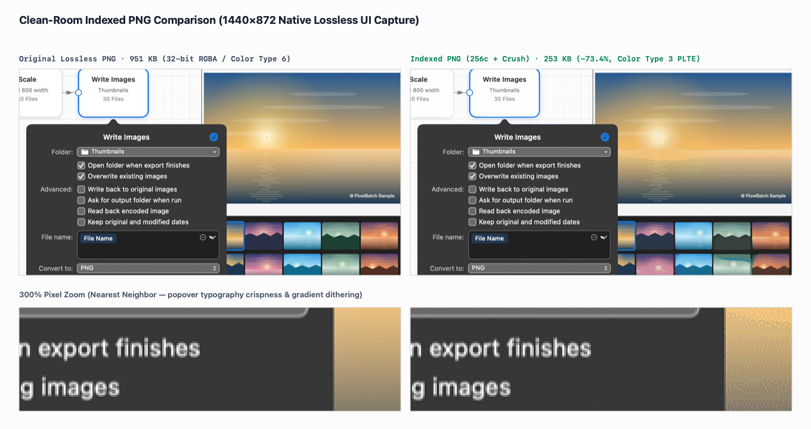

# FlowBatch Studio

An open-source, offline, node-based batch image processor written in native **Swift 6, AppKit, and Metal/Core Image** for macOS, inspired by [Retrobatch](https://flyingmeat.com/retrobatch/). Includes an early, experimental **Windows 11** port (`windows/`) built with Tauri 2 and Rust that shares the same `.flowbatch` JSON workflow format.

[Latest Release (macOS)](https://github.com/zm57cdj9yb-beep/flowbatch-studio/releases/latest) · [Example Workflows](examples/) · [Benchmarks](benchmarks/RESULTS.md) · [Discussions](https://github.com/zm57cdj9yb-beep/flowbatch-studio/discussions) · [MIT License](LICENSE)


## Overview

FlowBatch Studio lets you wire reusable directed acyclic graphs (DAGs) to batch resize, watermark, strip EXIF/GPS metadata, branch by rules, generate multi-scale sets, build multi-page PDFs, and quantize indexed PNGs — entirely offline with no subscriptions or Electron overhead.

- **Zero external Swift dependencies on macOS:** [`Package.swift`](Package.swift) links only Apple frameworks plus system `zlib` (`-lz`).
- **Visual DAG editor:** 67 built-in nodes across 15 categories, cycle detection, directional Bézier wires, `Rules` matched/unmatched dual-port routing, `Multi Scale` fan-out, live Metal preview, and coalesced undo/redo.
- **Built-in Indexed PNG quantization & crush:** Clean-room 2–256 color palette quantization with optional Floyd-Steinberg dithering, alpha transparency (`tRNS`), and lossless crush (`CZlib` on macOS, `oxipng` on Windows).
- **Memory-bounded macOS pipeline:** Separates subsampled contact-sheet thumbnails, cached GPU previews, and bounded full-resolution disk exports so large batches stay under 50 MB RSS.
- **Process-isolated JavaScript automation:** Run custom per-asset `processAsset(asset)` scripts with a hard 2.0-second timeout and no host filesystem/Cocoa API access.
- **Portable `.flowbatch` JSON workflows:** Plain-text, Git-friendly workflow files shared between the macOS Swift app and the experimental Windows Rust/Tauri 2 port (`windows/`).

## Benchmarks & Visual Proof

All numbers below were measured on an **Apple M2 (8 GB RAM, macOS 27.2)** using release builds (`swift build -c release` / `cargo build --release`) against **native lossless PNG fixtures** (never round-tripped through JPEG). Reproduce locally with [`./benchmarks/run_benchmarks.sh`](benchmarks/run_benchmarks.sh) or inspect full methodology and raw outputs in [`benchmarks/RESULTS.md`](benchmarks/RESULTS.md).

| Workload | On-Disk Lossless PNG | FlowBatch Indexed PNG (256c) | Size Reduction | Median Time | Peak RSS |
|---|---:|---:|---:|---:|---:|
| Native lossless UI capture (`1440×872` RGBA) — Swift fast (`speed=5`) | 950.7 KB | **149.6 KB** | **-84.3%** | **34.0 ms** | — |
| Native lossless UI capture (`1440×872` RGBA) — Swift dither + Crush | 950.7 KB | **253.0 KB** | **-73.4%** | 1,227.3 ms | — |
| Native lossless UI capture (`1440×872` RGBA) — Rust fast (`speed=5`) | 950.7 KB | **103.4 KB** | **-89.1%** | **26.7 ms** | — |
| Native lossless UI capture (`1440×872` RGBA) — Rust dither + `oxipng` Brute-Force | 950.7 KB | **227.2 KB** | **-76.1%** | 1,208.9 ms | — |
| Transparent RGBA icon (`512×512`, `PLTE`+`tRNS`) — Swift fast | 172.1 KB | **22.8 KB** | **-86.8%** | **7.2 ms** | — |
| Transparent RGBA icon (`512×512`, `PLTE`+`tRNS`) — Rust fast | 172.1 KB | **17.8 KB** | **-89.7%** | **4.8 ms** | — |
| 30-asset batch (`Watermark -> Scale 800px -> Indexed PNG`) — Swift 6 | — | 30 files (948 KB) | — | **556.8 ms** (53.9 img/s) | **46.9 MB** |
| 30-asset batch (`Watermark -> Scale 800px -> Indexed PNG`) — Rust* | — | 30 files (714 KB) | — | **382.6 ms** (78.4 img/s) | **109.6 MB** |

*\*Rust backend measured on the same Apple M2 macOS arm64 machine using Rayon parallelism and bounded 4-asset chunk streaming.*



## Comparison With Existing Tools

| Capability | FlowBatch Studio | Retrobatch Pro | ImageMagick | XnConvert | Squoosh |
|---|---|---|---|---|---|
| License & Price | MIT (Free) | Proprietary ($49.99) | Apache 2.0 (Free) | Free personal / Paid commercial | Apache 2.0 (Free) |
| Platforms | macOS 14+ (stable), Windows 11 (experimental) | macOS only | macOS, Windows, Linux | macOS, Windows, Linux | Browser |
| Visual DAG Branching | Yes (`Rules` dual-port, `Multi Scale`, multi-source) | Yes (mature) | No (CLI) | No (linear action list) | No (single image) |
| Built-in Indexed PNG + Crush | Yes (clean-room Swift + Rust `oxipng`) | Yes | Via flags / `pngquant` | Yes | Yes (`oxipng` + quant) |
| Format Breadth | 10 macOS / 8 Windows | ~15 + deep PSD layers | **200+ formats** | **500+ formats** | Modern web codecs (AVIF/JXL/WebP) |
| Headless Linux / Server CI | GUI-first | macOS CLI only | **Best-in-class** | `nconvert` CLI | CLI archived |
| Code Signing / Notarization | Ad-hoc signed today | **Apple Notarized** | Signed / Homebrew | **Signed** | Browser sandbox |
| Packaging | ~3.5 MB zip (macOS); source build (Windows) | Native macOS app | CLI binaries | Desktop installer | Zero install |

**When another tool is a better fit:**
- Use **ImageMagick** or **libvips** for headless Linux servers, Docker pipelines, or exotic formats.
- Use **Retrobatch Pro** if you want a notarized, commercially supported macOS app with deep PSD layer support and mature Apple Shortcuts integration.
- Use **Squoosh** for visually tuning single-image WebP/AVIF/JXL compression sliders in a browser.

## Example Workflows

Five ready-to-open `.flowbatch` recipes live in [`examples/`](examples/README.md) and are validated automatically by both Swift and Rust test suites:

- [`01-web-retina-png-crush.flowbatch`](examples/01-web-retina-png-crush.flowbatch) — Strip metadata, fit inside 1600px, fan out `1x` + `@2x`, write 256-color crushed Indexed PNGs.
- [`02-client-proofing-privacy.flowbatch`](examples/02-client-proofing-privacy.flowbatch) — Fix EXIF rotation, remove GPS, apply corner watermark with `[Date]`, resize to 1600px JPEG.
- [`03-smart-orientation-branching.flowbatch`](examples/03-smart-orientation-branching.flowbatch) — Route images via `Rules` (`Width > 1200`) into separate `16:9` and `1:1` crop + export branches.
- [`04-docs-screenshot-polisher.flowbatch`](examples/04-docs-screenshot-polisher.flowbatch) — Trim transparent edges, add a 16px border and drop shadow, export 128-color crushed Indexed PNGs.
- [`05-portfolio-pdf-and-contact-sheet.flowbatch`](examples/05-portfolio-pdf-and-contact-sheet.flowbatch) — Sort by filename, then fan out in parallel to a 4-column `Image Grid` PNG and a multi-page `PDF Maker` export.

## Install & Build

### macOS 14+ (Apple Silicon)

**Pre-built release:**
1. Download `FlowBatch-Studio-v1.0.0-macOS-arm64.zip` from [GitHub Releases](https://github.com/zm57cdj9yb-beep/flowbatch-studio/releases/latest).
2. Unzip and move `FlowBatch Studio.app` to `/Applications`.
3. This open-source build is **ad-hoc signed** (not Apple Developer notarized), so clear Gatekeeper quarantine once before launching:
   ```bash
   xattr -dr com.apple.quarantine "/Applications/FlowBatch Studio.app"
   open "/Applications/FlowBatch Studio.app"
   ```

**Build from source (requires macOS 14.0+ and Xcode / Swift 6):**
```bash
git clone https://github.com/zm57cdj9yb-beep/flowbatch-studio.git
cd flowbatch-studio

swift build
swift test
./scripts/build_app.sh release
codesign --verify --strict --verbose=2 "build/FlowBatch Studio.app"
open "build/FlowBatch Studio.app"
```

### Windows 11 (Experimental — Build From Source)

Pre-built Windows `.exe`/`.msi` installers are not published on Releases yet. To build locally on Windows 11 (requires Node.js 20+, Rust stable, and Visual Studio C++ Build Tools):

```powershell
git clone https://github.com/zm57cdj9yb-beep/flowbatch-studio.git
cd flowbatch-studio\windows

npm ci
npm run build
cd src-tauri
cargo test --release
cd ..
npx tauri build --bundles nsis,msi
```

## Architecture Notes

**Preview vs. Export memory split (macOS):** Contact-sheet thumbnails strictly use `CGImageSourceCreateThumbnailAtIndex` capped at 256px (preferring embedded RAW JPEGs) inside a 64 MB `NSCache` ([`ThumbnailLoader.swift`](Sources/FlowBatchCore/Engine/ThumbnailLoader.swift)). Interactive previews render into `MTKView` via a cached `previewContext` with monotonic generation-ID cancellation and 0.25× `CIRAWFilter.scaleFactor`, while disk exports use an uncached `exportContext` (`memoryTarget: 512` MB) inside per-asset `autoreleasepool` blocks monitored by `DispatchSourceMemoryPressure` ([`PipelineRunner.swift`](Sources/FlowBatchCore/Engine/PipelineRunner.swift)).

**Clean-room Indexed PNG encoder:** Instead of calling an external binary, [`IndexedPNGQuantizer.swift`](Sources/FlowBatchCore/Engine/IndexedPNGQuantizer.swift) implements Median-Cut quantization, alpha unpremultiplication, a 16K direct-mapped lookup cache, and **Cauchy-Schwarz luminance branch-and-bound pruning** for exact nearest-palette search, followed by 1/2/4/8-bpp bit-packing and manual PNG chunk writing (`IHDR`, `sRGB`, `PLTE`, `tRNS`, `IDAT`, `IEND`) backed by system `zlib` (`CZlib`). Crush mode compares Filter None (`0`) and per-row adaptive SAD filters across zlib strategies at level 9 and keeps the smallest payload.

**Process-isolated JavaScript node (macOS):** [`FlowBatchJSWorker`](Sources/FlowBatchJSWorker/main.swift) runs user scripts inside an isolated subprocess `JSVirtualMachine` communicating over stdin/stdout JSON. Only the `asset` DTO (`fileName`, `width`, `height`, `dpi`, `tags`, `skip()`, `setOutputName()`) and `console.log` are exposed, with a 2.0-second `SIGTERM` timeout. See [`SECURITY.md`](SECURITY.md) for the full trust model covering shell/script nodes.

## Platform Status & Known Limitations

- **macOS signing:** Releases are ad-hoc signed rather than Apple Developer ID notarized.
- **macOS batch concurrency:** `PipelineRunner.runWorkflow` currently processes assets sequentially (one full-res asset at a time) to keep peak RAM flat (`46.9 MB` measured on 30 assets); RAM-tiered `TaskGroup` concurrency (`safeExportConcurrencyLimit`) is not wired up yet.
- **macOS formats:** Exports PNG (standard & indexed), JPEG, HEIC, AVIF, TIFF, GIF (including animated), JPEG 2000, BMP, and PDF. WebP and PSD are read-only because macOS `ImageIO` does not ship encoders for them.
- **Experimental Windows port (`windows/`):**
  - Core image transforms, filters, DAG routing, `Multi Scale`, clean-room Indexed PNG + `oxipng`, WebP/ICO/PNG/JPEG/TIFF/GIF/BMP export, and pure-Rust multi-page PDF 1.4 Maker/Extractor work and pass unit tests.
  - Several macOS-native nodes are currently stubs/no-ops on Windows: `Prompt for Files`, `Clipboard`, `Screenshot`, `Write to Clipboard`, `Open in Another App`, `Fix EXIF Rotation`, and `Layer & Page Splitter`.
  - EXIF/GPS/ICC metadata writing, camera RAW decoding, full JavaScript execution (currently a minimal zero-side-effect inline rule evaluator), and TrueType watermark text rendering (currently a 5×7 uppercase ASCII bitmap fallback) are not yet implemented on Windows.
  - Standard DAGs stream in bounded 4-asset Rayon chunks (`109.6 MB` Peak RSS on 30 assets); multi-asset collector nodes (`PDF Maker`, `Image Grid`, `Animated Image`, `Sort Order`) still buffer their input stage in RAM.

## Built-In Nodes

<details>
<summary>Complete 15-category / 67-node inventory (* = macOS-only or stubbed on Windows)</summary>

| Category | Nodes |
|---|---|
| Read Images (5) | `Read Folder`, `Read Individual Files`, `Prompt for Files`*, `Clipboard`*, `RAW Process`* |
| Write Images (4) | `Write Images`, `Write to Clipboard`*, `Open in Another App`*, `Multi Scale` |
| Blur (5) | `Gaussian Blur`, `Box Blur`, `Motion Blur`, `Noise Reduction`, `Pixelate` |
| Color Adjustment (7) | `Exposure`, `Brightness & Contrast`, `Vibrance`, `Gamma`, `Temperature & Tint`, `Shadows & Highlights`, `Color Profile` |
| Color Effect (10) | `Photo Effect`, `Sepia`, `Color Invert`, `Color Posterize`, `1-Bit`, `Dither`, `Matte`, `Add Border`, `Drop Shadow`, `Document Enhancer` |
| Generator (4) | `Blank Image`, `Screenshot`*, `Image Grid`, `Animated Image` |
| Metadata (5) | `Delete Metadata`*, `Remove GPS`*, `Set DPI`*, `Set General Metadata`*, `Fix EXIF Rotation`* |
| Misc (7) | `Change Bits Per Channel`*, `Duplicate`, `Delay`, `Layer & Page Splitter`*, `Extract Portrait Matte`*, `Contrast Stretch`, `Custom Convolution` |
| PDF (2) | `PDF Maker`, `PDF Image Extractor` |
| Photos Library (2) | `Read Photos Library` *(Windows Pictures)*, `Import to Photos` *(Windows Pictures)* |
| Script (3) | `JavaScript` *(isolated JSC on macOS; inline evaluator on Windows)*, `Shell Script`, `AppleScript` *(PowerShell on Windows)* |
| Sharpen (2) | `Sharpen Luminance`, `Unsharp Mask` |
| Sort (3) | `Rules`, `Classify Images` *(Vision ML on macOS; color/luma heuristic on Windows)*, `Sort Order` |
| Transform (6) | `Scale`, `Crop`, `Rotate`, `Flip`, `Trim to Edges`, `Upscale & Sharpen` |
| Watermark (2) | `Text Watermark` *(CoreText on macOS; 5×7 bitmap on Windows)*, `Image Watermark` |

</details>

## Contributing & Security

See [`CONTRIBUTING.md`](CONTRIBUTING.md) for local test commands, cross-platform node guidelines, and open parity tasks. For vulnerability reporting and the script-node trust model, see [`SECURITY.md`](SECURITY.md). Participation is governed by [`CODE_OF_CONDUCT.md`](CODE_OF_CONDUCT.md).

## License

Released under the [MIT License](LICENSE).
